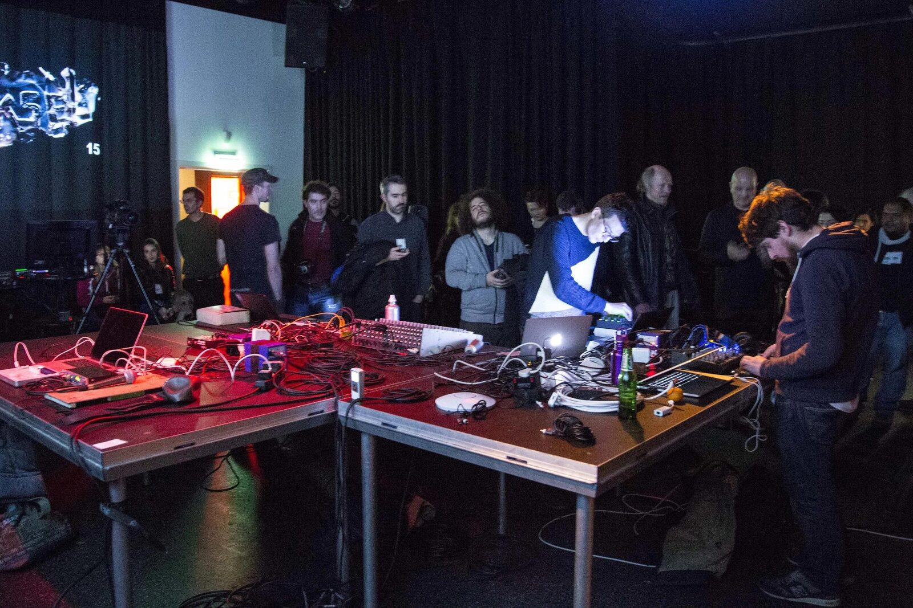
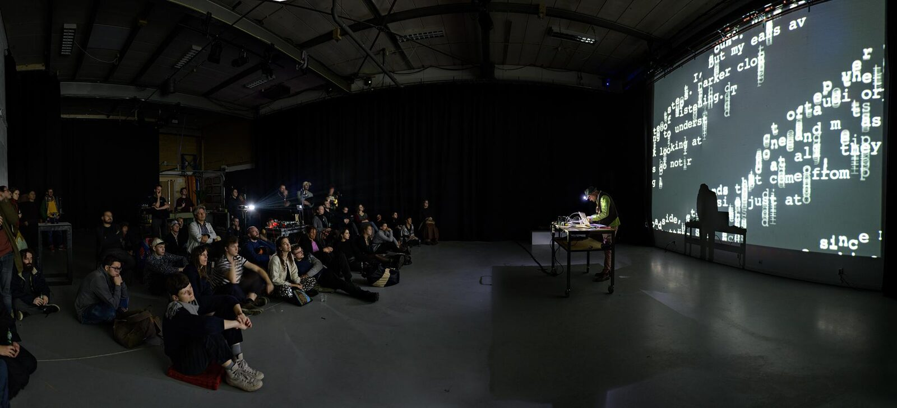
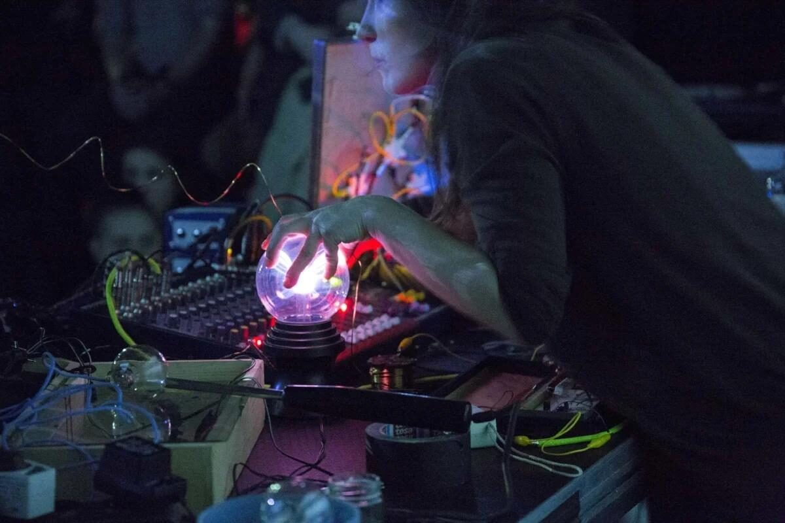
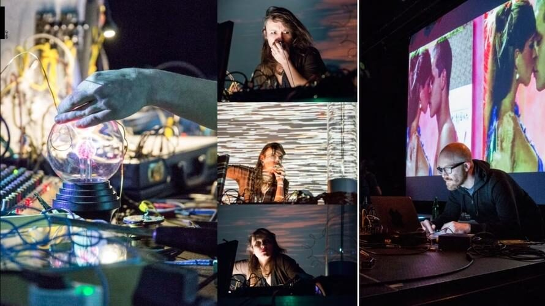

Bergen, Noruega. Del 19 al 22 de noviembre de 2026, la edición 24 de PIKSEL ocupa Bergen Assembly. Entrada libre. Cuatro días de instalaciones, performances audiovisuales, talleres, seminarios y presentaciones donde el código, los circuitos y los sistemas computacionales son materiales de creación.

PIKSEL reúne a artistas, programadores, músicos e investigadores que trabajan con software libre, electrónica experimental y medios digitales. No es una feria de novedades tecnológicas. Es un espacio para exhibir, investigar y experimentar con las herramientas que usamos todos los días, pero que casi nunca vemos por dentro.

---

## Un festival para abrir la máquina

La premisa del festival es simple y política: la tecnología no es una caja negra intocable. Se puede estudiar, modificar, romper y volver a armar.

Esa idea atraviesa el programa completo. Las instalaciones interactivas, las performances y los talleres no muestran productos terminados. Muestran procesos, prototipos y preguntas abiertas sobre cómo construimos y habitamos los sistemas técnicos.

PIKSEL se define como un festival internacional para el arte y la libertad tecnológica. La frase importa: la libertad no está en el acceso a una interfaz, sino en la posibilidad real de entender y transformar lo que ocurre detrás.

---

## Software que se puede tocar

Una parte central del festival gira alrededor del software libre y del código abierto. Prácticas que permiten estudiar, modificar y compartir las herramientas de creación digital.

No se trata solo de licencias. Se trata de quién controla el conocimiento, quién puede auditar un programa y quién puede continuar un proyecto cuando su autor desaparece.

El hardware abierto ocupa el mismo lugar. Circuitos electrónicos, microcontroladores y dispositivos intervenidos forman parte de instalaciones artísticas, instrumentos musicales y sistemas interactivos. La electrónica no funciona como decoración: estructura la obra, define sus tiempos y condiciona lo que puede hacerse con ella.

---

## Programar en vivo

El live coding es una de las prácticas más visibles del ecosistema PIKSEL. Consiste en escribir y modificar código durante una presentación para generar música, imágenes o animaciones en tiempo real.

La programación se convierte en actividad pública. El código modifica el sonido y la imagen mientras la presentación ocurre. No hay una versión final escondida: hay una pantalla, una persona tecleando y un resultado que cambia con cada línea.

El error deja de ser un accidente vergonzoso y pasa a ser parte del lenguaje. Un bucle mal escrito puede producir un drone. Una variable inesperada puede abrir una textura nueva.

El festival también incluye arte generativo, síntesis audiovisual, circuit bending y experimentación con interfaces electrónicas. Prácticas que comparten una misma decisión: usar la computadora como instrumento, no como simple ejecutora.

---

## Computación lenta

Frente a la nube infinita y los modelos cada vez más grandes, PIKSEL trabaja con computación de bajo consumo, reutilización de hardware y ejecución local de software.

En la edición 2026 destaca *From Compost to Code: Reimagining Radical Computing*, un programa que explora la relación entre procesos biológicos y sistemas computacionales.

Uno de sus proyectos, desarrollado por **Shinji Toya**, utiliza celdas de combustible microbianas para generar electricidad a partir del compost. El objetivo es alimentar un pequeño computador de bajo consumo. *Microbial Feral Computing with a Compost Computer* no busca eficiencia industrial: busca ritmos biológicos, energía inestable y una relación distinta con el tiempo de la máquina.

El programa también incluye talleres sobre ejecución local de modelos de inteligencia artificial. La propuesta consiste en instalar modelos con pesos abiertos en computadores personales, sin depender de servicios en la nube. Antes de instalar, se discute el costo ambiental y político de la IA contemporánea: datos extraídos, energía, agua, vigilancia y control corporativo.

---

## Archivo y comunidad

PIKSEL mantiene un archivo de festivales, instalaciones, talleres y presentaciones de distintas ediciones. Esa memoria permite observar la evolución del arte digital y de las prácticas experimentales relacionadas con la informática.

El archivo también funciona como infraestructura afectiva. Proyectos que podrían haber desaparecido siguen disponibles para quien quiera estudiarlos, reproducirlos o modificarlos.

El festival conecta programación, electrónica, música y artes visuales. Disciplinas que comparten herramientas y procesos, aunque habitualmente se desarrollen en espacios separados.

PIKSEL permite conocer proyectos donde el código, los circuitos y los sistemas computacionales son materiales de creación. Y recuerda algo que la industria prefiere olvidar: la tecnología libre no se exhibe, se practica.

---

## Referencias

- [PIKSEL — Sitio oficial](https://piksel.no/)
- [PIKSEL Festival 2026](https://26.piksel.no/)
- [From Compost to Code: Reimagining Radical Computing](https://piksel.no/2026/10/16/from-compost-to-code-reimagining-radical-computing)
- [Permacomputing](https://permacomputing.net/)
